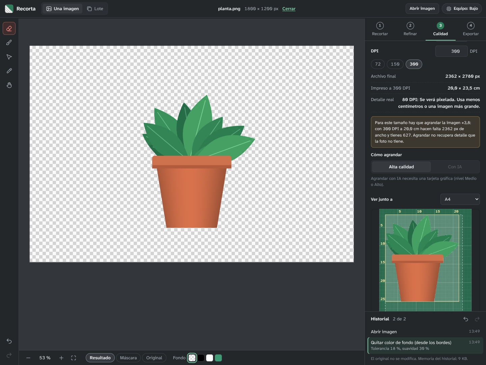

# Recorta

Quita el fondo de tus imágenes, corrige el borde a mano y exporta el PNG con el tamaño, los DPI y el peso que necesitas. Gratis y portable: la IA corre en tu computadora, sin cuentas ni límites diarios, y después de descargar el modelo una vez funciona sin conexión.



## Qué hace

El trabajo se ordena en cuatro pasos, siempre visibles a la derecha:

1. **Recortar.** La IA quita el fondo (o lo haces sin IA con el gotero, ideal para logos). Si la IA elige mal, marcas con un clic qué objeto quieres.
2. **Refinar.** Pincel para borrar o recuperar, ajustes del borde (suavizar, contraer, endurecer) y *Quitar halo*, que limpia el color del fondo viejo pegado al contorno.
3. **Calidad.** Eliges para qué es (web, imprimir, tienda online, sticker) y la app explica en lenguaje simple el tamaño, los DPI, el formato y el peso. Muestra el tamaño impreso real sobre una base de corte, junto a una hoja de referencia (A4, Carta, A3…).
4. **Exportar.** Ves el archivo exacto (medidas, peso y aspecto) antes de guardarlo. El PNG lleva sus DPI y, si quieres, una *ficha* con los pasos que hiciste.

Además: modo **Lote** para procesar muchas imágenes con los mismos ajustes, **historial** con cada paso nombrado (deshacer y volver a cualquier punto) y la imagen original intacta siempre.

La lista completa de opciones, con qué hace cada una, está en [docs/FUNCIONES.md](docs/FUNCIONES.md).

## Empezar

Necesitas [Node.js](https://nodejs.org) 22.12 o más nuevo. Luego, en una terminal dentro de la carpeta del proyecto:

```bash
npm install
npm run dev
```

Abre <http://localhost:5173> en Chrome o Edge. La primera vez que uses la IA se descarga el modelo (de 5 a 115 MB según tu equipo); después funciona sin internet.

| Comando | Para qué |
| --- | --- |
| `npm run dev` | Usar la app mientras la modificas (se recarga sola). |
| `npm run check` | Revisar tipos, correr las pruebas y compilar. Úsalo después de cada cambio. |
| `npm run build` | Crear la versión final en `dist/`. |
| `npm run preview` | Probar esa versión final en <http://localhost:4173>. |
| `npm run models:download` | Descargar los modelos para usar la app 100 % sin internet. |
| `npm run desktop:build` | Crear la app de escritorio (necesita Rust; ver abajo). |

Todos los comandos, explicados uno por uno: [docs/COMANDOS.md](docs/COMANDOS.md).

## Funciona en computadoras viejas

Al abrirse, la app revisa la tarjeta gráfica, el procesador y la memoria, y elige uno de tres niveles. Si un nivel falla durante el uso, baja al siguiente sola y te avisa.

| Nivel | Equipo típico | Dónde corre la IA | Modelo para quitar el fondo |
| --- | --- | --- | --- |
| **Alto** | Tarjeta gráfica dedicada (NVIDIA, AMD Radeon RX, Intel Arc), 16 GB de RAM | Tarjeta gráfica | BiRefNet lite a 1024 px (~115 MB) |
| **Medio** | Gráfica integrada moderna (Intel Iris Xe, Radeon integrada, Apple M), 8 GB | Tarjeta gráfica | BiRefNet lite a 512 px + afinado con la foto original (~99 MB) |
| **Bajo** | Cualquier PC con Windows 10/11 de 64 bits y 4 GB, aunque no tenga WebGPU | Procesador | U²-Net liviano a 320 px (~5 MB) |

Detalles, límites de cada nivel y cómo forzar uno: [docs/HARDWARE.md](docs/HARDWARE.md).

## App de escritorio portable (Windows)

La misma app empaquetada con [Tauri](https://tauri.app): un solo `.exe` que no necesita instalación y trae incluido el modelo del nivel Bajo, así que quita fondos sin internet desde el primer uso. No hace falta que instales Rust: GitHub la compila por ti.

1. Sube el proyecto a GitHub ([guía paso a paso](docs/GITHUB.md)).
2. Pestaña **Actions** → **App de escritorio** → **Run workflow**.
3. Al terminar (entre 10 y 20 minutos la primera vez), descarga `recorta-windows` desde esa misma ejecución: trae el `.zip` portable y el instalador.

Si creas una etiqueta de versión (`git tag v1.0.0` y `git push --tags`), los archivos además quedan publicados en la sección **Releases**.

## Versión web en GitHub Pages

Cada cambio que subes a `main` se publica en `https://<tu-usuario>.github.io/<repositorio>/`. Hay que activarlo una vez: **Settings → Pages → Source: GitHub Actions**. Ver [docs/GITHUB.md](docs/GITHUB.md).

## Privacidad y variables de entorno

- Las imágenes nunca salen de la computadora. Lo único que se descarga de internet son los modelos de IA, una sola vez, desde Hugging Face.
- La configuración opcional va en un archivo `.env` (copia `.env.example`). El `.env` **no se sube** a GitHub: lo impide `.gitignore`.
- Todo lo que empieza con `VITE_` queda dentro de la app compilada y cualquiera puede leerlo. No guardes contraseñas ni claves ahí. Recorta no necesita ninguna.

## Limitaciones conocidas

- La precisión del recorte depende del nivel: en computadoras sin tarjeta gráfica compatible el modelo es liviano y el borde sale menos fino. Para logos e ilustraciones, *Quitar el color de los bordes* da mejores bordes en cualquier equipo.
- En GitHub Pages la IA en procesador usa un solo hilo (GitHub no permite las cabeceras necesarias); en la app de escritorio no pasa.
- El `.exe` no está firmado: Windows muestra un aviso la primera vez ([qué hacer](docs/SOLUCION-DE-PROBLEMAS.md#app-de-escritorio-windows)).
- Probado en navegadores basados en Chromium (Chrome, Edge y el motor de la app de escritorio). Firefox y Safari deberían funcionar, con menos pruebas.
- No abre fotos HEIC de iPhone: hay que exportarlas antes como JPG.

## Estructura

```
recorta/
├── src/                  Código de la app (React + TypeScript)
│   ├── ai/               IA: modelos, worker y carga desde Hugging Face o la carpeta local
│   ├── imaging/          Procesamiento de imagen: máscaras, bordes, PNG, DPI, paletas
│   ├── editor/           Lienzo, zoom y pinceles
│   ├── hardware/         Detección del equipo y niveles Alto/Medio/Bajo
│   ├── export/           Destinos (web, imprimir…), tamaño final y ficha
│   ├── state/            Estado, acciones, historial y lote
│   └── ui/               Pantallas, paneles y controles
├── tests/                Pruebas automáticas (npm test)
├── src-tauri/            App de escritorio (Tauri 2)
├── scripts/              Descarga de modelos para uso sin internet
├── docs/                 Documentación
├── .github/workflows/    Revisión, publicación web y compilación para Windows
├── .env.example          Variables de entorno documentadas
└── .gitignore            Lo que no se sube a GitHub
```

Cómo encaja cada parte y dónde tocar para cambiar algo: [docs/ARQUITECTURA.md](docs/ARQUITECTURA.md).

## Documentación

- [FUNCIONES.md](docs/FUNCIONES.md): todas las opciones de la app, paso por paso.
- [HARDWARE.md](docs/HARDWARE.md): niveles de equipo, detección y límites.
- [COMANDOS.md](docs/COMANDOS.md): qué hace cada comando.
- [GITHUB.md](docs/GITHUB.md): subir el proyecto, publicar la web y compilar el `.exe`.
- [ARQUITECTURA.md](docs/ARQUITECTURA.md): cómo está hecho por dentro.
- [DESARROLLO-CON-IA.md](docs/DESARROLLO-CON-IA.md): cómo seguir el proyecto con asistentes de IA sin romperlo.
- [SOLUCION-DE-PROBLEMAS.md](docs/SOLUCION-DE-PROBLEMAS.md): errores comunes y qué hacer.
- [LICENCIAS.md](docs/LICENCIAS.md): licencias de la app, las librerías y los modelos de IA.

## Licencia

Código bajo licencia [MIT](LICENSE). Los modelos de IA tienen licencias propias; antes de un uso comercial lee [docs/LICENCIAS.md](docs/LICENCIAS.md).
