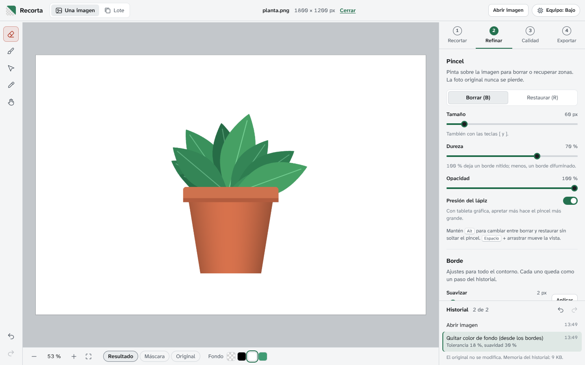

# Funciones de Recorta

Todas las opciones de la app, en el orden en que aparecen. Cada cambio sobre la imagen queda como un paso con nombre en el **Historial** (abajo a la derecha), y la imagen original nunca se modifica: lo que cambia es una máscara que dice qué se ve y qué no.

- [Abrir imágenes](#abrir-imágenes)
- [Herramientas y vista](#herramientas-y-vista)
- [Paso 1: Recortar](#paso-1-recortar)
- [Paso 2: Refinar](#paso-2-refinar)
- [Paso 3: Calidad](#paso-3-calidad)
- [Paso 4: Exportar](#paso-4-exportar)
- [Lote](#lote)
- [Historial](#historial)
- [Equipo](#equipo)
- [Atajos de teclado](#atajos-de-teclado)
- [Qué guarda la app y dónde](#qué-guarda-la-app-y-dónde)

## Abrir imágenes

- **Formatos:** PNG, JPG, WebP, AVIF, GIF (primer cuadro) y BMP.
- **Formas de abrir:** botón *Elegir imagen*, *Abrir imagen* (barra superior), arrastrar el archivo a la ventana o pegar con <kbd>Ctrl</kbd>+<kbd>V</kbd>.
- **Si el PNG ya tenía transparencia**, se respeta: el historial empieza con "Abrir imagen (ya tenía transparencia)".
- **Fotos de celular giradas:** se corrigen solas según la orientación guardada en el archivo.
- **DPI del archivo original:** se leen de PNG y JPG.
- **Imágenes muy grandes:** cada nivel de equipo edita hasta cierto tamaño (Alto 48 MP, Medio 24 MP, Bajo 12 MP). Si la imagen es más grande, se abre achicada y la app lo avisa. Ver [HARDWARE.md](HARDWARE.md).

## Herramientas y vista

**Barra izquierda (herramientas):**

| Herramienta | Tecla | Qué hace |
| --- | --- | --- |
| Borrar | <kbd>B</kbd> | Pincel que vuelve transparente lo que pintas. |
| Restaurar | <kbd>R</kbd> | Pincel que recupera la imagen original donde pintas. |
| Seleccionar con un clic | <kbd>S</kbd> | Marca un objeto con clics; la IA calcula su contorno. |
| Gotero | <kbd>I</kbd> | Clic sobre un color para borrarlo (sin IA). |
| Mover la vista | <kbd>H</kbd> | Arrastrar mueve la imagen. También <kbd>Espacio</kbd> + arrastrar, o el botón del medio del mouse. |
| Deshacer / Rehacer | <kbd>Ctrl</kbd>+<kbd>Z</kbd> / <kbd>Ctrl</kbd>+<kbd>Y</kbd> | Recorren el historial. |

Con cualquier pincel, mantener <kbd>Alt</kbd> cambia entre borrar y restaurar sin soltar el trazo.

**Barra inferior (vista):**

- **Zoom:** <kbd>−</kbd> / <kbd>+</kbd>, la rueda del mouse (acerca hacia el puntero), clic en el porcentaje para ver al 100 %, botón *Ajustar* (<kbd>Ctrl</kbd>+<kbd>0</kbd>).
- **Qué ver:** *Resultado* (cómo va a quedar), *Máscara* (lo borrado se ve en rojo, como la película de enmascarar de imprenta) y *Original* (la imagen sin cambios, para comparar).
- **Fondo de la vista:** damero, negro, blanco o un color propio (el último cuadrito abre el selector). Solo cambia lo que ves en pantalla, no el archivo. Sirve para revisar bordes: los halos claros se notan sobre negro y los oscuros sobre blanco.

## Paso 1: Recortar

### Quitar el fondo con IA

- **Quitar fondo con IA:** separa el objeto principal del fondo. El modelo depende del nivel de equipo y debajo del botón se ve cuál se usa y cuánto pesa la descarga (una sola vez).
- **Calidad en nivel Bajo** (solo en nivel Bajo): *Rápida* (U²-Net liviano, 5 MB) o *Mejor* (U²-Net completo, 176 MB, más preciso y más lento).
- **Afinar el borde con la foto original** (encendido por defecto): la IA trabaja con una copia chica de la imagen; esta opción ajusta el borde resultante a los detalles reales de la foto en alta resolución (pelo, bordes finos). Apagarlo solo agranda la máscara de la IA, más suave y menos preciso.
- **Si un nivel falla** (falta de memoria de video, tarjeta no compatible), la app reintenta sola con el nivel siguiente y te avisa cuál usó.

### Seleccionar con un clic

Para cuando hay varios objetos o la IA eligió mal.

- **Clic** sobre la imagen: incluir esa zona. **Clic derecho** o <kbd>Alt</kbd> + clic: excluirla. Puedes marcar varios puntos.
- La primera vez analiza la imagen (unos segundos) y descarga el modelo SlimSAM (14 a 21 MB).
- Muestra la **confianza de la IA** sobre la selección.
- Qué hacer con la selección:
  - **Dejar solo esto:** borra todo lo demás.
  - **Quitar esto:** borra lo seleccionado (por ejemplo, una persona que se coló en la foto).
  - **Sumar esto:** recupera lo seleccionado si se había borrado.
  - **Borrar puntos:** empieza la selección de nuevo.

### Quitar un color de fondo (sin IA)

Ideal para logos, ilustraciones y productos sobre fondo liso. Es instantáneo y funciona en cualquier equipo.

- **Quitar el color de los bordes:** detecta el color que más se repite en el borde de la imagen y lo borra.
- **Usar el gotero:** activa el gotero; cada clic borra el color de ese punto.
- **Tolerancia:** cuánto puede diferir un color del elegido para borrarse. Sube si quedan restos; baja si se borra parte del objeto.
- **Suavidad del borde:** transición gradual en lugar de un corte seco.
- **Solo zonas conectadas:** encendido, borra solo el color que toca la zona donde empezó (el blanco del fondo, pero no el blanco de adentro de una letra O). Apagado, borra ese color en toda la imagen.

### Empezar de nuevo

- **Restaurar todo:** vuelve a mostrar la imagen completa (queda como un paso: se puede deshacer).
- **Invertir:** lo visible se borra y lo borrado aparece. Útil para quedarte con el fondo.

## Paso 2: Refinar

### Pincel

- **Borrar (B) / Restaurar (R).**
- **Tamaño:** de 1 a 500 px (también con las teclas <kbd>[</kbd> y <kbd>]</kbd>).
- **Dureza:** 100 % deja un borde nítido; menos, un borde difuminado.
- **Opacidad:** borrar al 50 % deja la zona semitransparente. Pasar dos veces por el mismo lugar en un mismo trazo no acumula; un trazo nuevo sí.
- **Presión del lápiz:** con tableta gráfica, apretar más hace el pincel más grande.

### Borde

Ajustes para todo el contorno a la vez. Cada uno se aplica con su botón y queda como un paso del historial.

- **Suavizar** (1 a 30 px): difumina el borde.
- **Desplazar** (−30 a +30 px): negativo contrae el borde hacia adentro (limpia restos de fondo pegados), positivo lo expande. Contraer 1 o 2 px suele bastar.
- **Endurecer** (1 a 100 %): vuelve más nítido un borde demasiado suave.

### Quitar halo

Los píxeles semitransparentes del borde conservan parte del color del fondo viejo: si recortas a alguien de un fondo verde y lo pones sobre blanco, se ve un contorno verdoso. *Quitar halo* recalcula el color de esos píxeles a partir del objeto.

- **Quitar halo:** encendido/apagado (queda en el historial).
- **Intensidad:** cuánto se corrige. 100 % es lo habitual.
- No cambia qué se borra, solo el color del borde. Se aplica también al exportar.

## Paso 3: Calidad

### ¿Para qué es?

Elegir un destino configura todo lo demás. Después puedes cambiar cualquier ajuste (el destino pasa a *personalizado*).

| Destino | Formato | Tamaño | DPI | Otros |
| --- | --- | --- | --- | --- |
| **Web y redes** | PNG automático (PNG-8 si alcanza, si no PNG-24), optimizado | Original | 72 | Sin bordes vacíos |
| **Imprimir** | PNG-24 | Ancho en centímetros (empieza en el tamaño natural a 300 DPI) | 300 | Avisa si faltan píxeles |
| **Tienda online** | JPG calidad 90 | Cuadrado de 2000 × 2000 px | 72 | Fondo blanco, margen 6 % |
| **Sticker** | WebP calidad 90 | Cuadrado de 512 × 512 px | 72 | Transparente, margen 3 % |

### Tamaño y DPI

- **Cómo definir el tamaño:**
  - *Original:* los píxeles que tiene el recorte.
  - *%:* escala de 5 a 400 %.
  - *Ancho px:* ancho exacto en píxeles (el alto se calcula).
  - *Impresión:* ancho en centímetros; los píxeles salen de multiplicar por los DPI.
  - *Lado máx.:* el lado más largo mide lo que indiques.
- **DPI:** número libre (1 a 2400) o los atajos 72, 150 y 300. El DPI no cambia los píxeles: indica a qué tamaño se imprime la imagen. InDesign, Illustrator y las imprentas lo usan; en web y pantallas no importa.
- **Datos que se muestran siempre:** tamaño del archivo final en píxeles y cuánto mide impreso a esos DPI.
- **Detalle real** (modo Impresión): los DPI que de verdad tendrá la impresión según los píxeles disponibles, con una valoración en palabras: nítida aunque se mire de cerca (290 DPI o más), buena de cerca (200 o más), sirve para piezas que se miran de lejos (120 o más) o se verá pixelada (menos de 120).
- **Ver junto a:** la *base de corte* dibuja el tamaño impreso real junto a una hoja de referencia (A4, Carta, A3, A5 o foto 10 × 15), con cuadrícula de 1 cm (de 5 cm en piezas de más de 60 cm).

### Agrandar (aparece solo si el tamaño pedido es mayor que la imagen)

La app avisa cuánto hay que agrandar y por qué ("con 300 DPI a 20 cm hacen falta 2362 px de ancho y tienes 1200"). Agrandar no recupera detalle que la foto no tiene.

- **Alta calidad:** remuestreo Lanczos, sin inventar nada. Funciona en todos los niveles.
- **Con IA** (niveles Medio y Alto): Swin2SR (54 MB) duplica el tamaño inventando detalle creíble en bordes y texturas, pero puede crear detalles que no existían. Si hace falta más de ×2 y la imagen es chica, hace dos pasadas (×4); el ajuste final al tamaño exacto se hace con Lanczos. Tamaño máximo de entrada: 1 MP en Medio y 4 MP en Alto; por encima se usa *Alta calidad* y se avisa. La transparencia se agranda aparte con Lanczos, para que la IA no altere el contorno.

### Formato y peso

- **PNG:** con transparencia y DPI. Es el formato recomendado para recortes.
  - **Recomendación automática:** la app analiza la imagen y explica qué conviene. Por ejemplo, para un logo: "La imagen tiene 3 colores: entran completos en una paleta de PNG-8, que se ve idéntica y pesa menos"; para una foto: "Tiene degradés o fotografía. Con PNG-8 aparecerían escalones de color visibles".
  - **Tipo de PNG:** *Automático* (sigue la recomendación), *PNG-24* (todos los colores) o *PNG-8* (paleta de hasta 256 colores: pesa mucho menos, pero no sirve para fotos ni degradés).
  - **Colores de la paleta** (PNG-8): de 2 a 256. Si la imagen tiene menos colores que el límite, la paleta es exacta y no se pierde nada.
  - **Tramado** (PNG-8): disimula los escalones de color con un patrón fino de puntos (Floyd–Steinberg).
  - **Optimizar el peso sin pérdida:** recomprime con OxiPNG. Mismos píxeles, menos peso; tarda un poco más.
- **WebP:** pesa poco y admite transparencia, pero **no guarda DPI**. Ideal para web y stickers.
- **JPG:** sin transparencia (el fondo se rellena con el color elegido en Exportar, blanco por defecto), con pérdida. Guarda los DPI.
- **Calidad** (WebP y JPG): de 30 a 100 %.

## Paso 4: Exportar

### Lienzo

- **Quitar bordes vacíos:** recorta el lienzo justo al contorno del objeto.
- **Margen:** espacio alrededor, como porcentaje del lado más largo (0 a 30 %).
- **Lienzo cuadrado:** centra el objeto en un cuadrado.
- **Fondo:** *Transparente* o *Color* (con selector). En JPG siempre es color.

### Archivo

- **Nombre:** se propone `nombre-original-recorte`. Los caracteres que Windows no acepta se quitan solos.
- **Guardar la ficha dentro del PNG:** escribe en los metadatos del archivo el tamaño, los DPI y los pasos que hiciste.

### Resultado

- **Preparar y ver el resultado:** genera el archivo final y muestra la vista previa con su tamaño, **peso real**, medida impresa y formato (por ejemplo, "PNG-8, 3 colores (sin pérdida), optimizado").
- Si cambias algo después de preparar, se avisa y al guardar se vuelve a preparar.
- **Guardar archivo** (<kbd>Ctrl</kbd>+<kbd>S</kbd>): abre el diálogo "Guardar como" donde el navegador lo permite (Chrome, Edge, la app de escritorio); si no, se descarga a la carpeta de descargas.
- **Guardar ficha:** guarda un `.txt` con la trazabilidad del archivo: imagen de origen, medidas, DPI, formato, peso, nivel de equipo y modelo de IA usados, y la lista de pasos.
- **Ver la ficha:** la muestra sin guardarla.

## Lote

Pestaña *Lote* (barra superior). Procesa muchas imágenes con las mismas indicaciones, una a la vez para no saturar la memoria.

- **Agregar imágenes:** botón o arrastrar varias a la vez. Si arrastras o pegas varias imágenes en el editor, pasan solas al lote.
- **Qué hacer con cada imagen:**
  - *Quitar fondo con IA* (usa el nivel de equipo actual; si falla, baja de nivel solo).
  - *Quitar color* (el color de los bordes, sin IA).
  - *Solo exportar* (cambiar tamaño, formato o DPI sin recortar).
- **Desplazar borde**, **Suavizar borde** y **Quitar halo:** los mismos ajustes de Refinar, aplicados a todas.
- **Cómo guardarlas:** usa los ajustes de Calidad y Exportar del editor, o uno de los destinos (Web y redes, Imprimir, Tienda online, Sticker). Agrandar con IA no se aplica en lote.
- **Procesar:** muestra el estado de cada imagen (*Pendiente*, *Procesando*, *Listo* o *Error*) con su tamaño final y peso. Se puede **cancelar**.
- **Descargar .zip:** todas juntas en un solo archivo.
- **Abrir en el editor:** lleva una imagen del lote al editor para retocarla a mano.

## Historial

- Cada acción queda con nombre, hora y detalle: *Quitar fondo con IA* ("BiRefNet lite, 512 px (GPU), 2,1 s"), *Borrar con pincel*, *Quitar halo: activado*, *Invertir lo visible y lo borrado*.
- **Clic en un paso** vuelve a ese punto. Si después haces algo nuevo, los pasos que estaban "adelante" se descartan (como en Photoshop).
- **Memoria:** el historial guarda copias comprimidas de la máscara y muestra cuánto ocupa. El máximo de pasos depende del nivel (Alto 60, Medio 40, Bajo 20) y de `VITE_MAX_HISTORY`.

## Equipo

Botón *Equipo* (arriba a la derecha). Ver [HARDWARE.md](HARDWARE.md).

- Muestra lo detectado: tarjeta gráfica, WebGPU, media precisión, núcleos del procesador, memoria, si la IA en procesador puede usar varios hilos y si estás en el navegador o en la app de escritorio.
- **Probar rendimiento:** mide cuánto tarda la IA en tu tarjeta gráfica y recomienda el nivel según esa medición real.
- **Nivel:** *Automático* (recomendado) o forzar *Alto*, *Medio* o *Bajo*. Los niveles que tu equipo no puede usar aparecen bloqueados con el motivo.

## Atajos de teclado

| Atajo | Acción |
| --- | --- |
| <kbd>B</kbd> / <kbd>R</kbd> | Pincel borrar / restaurar |
| <kbd>S</kbd> | Seleccionar con un clic |
| <kbd>I</kbd> | Gotero |
| <kbd>H</kbd> | Mover la vista |
| <kbd>[</kbd> / <kbd>]</kbd> | Achicar / agrandar el pincel |
| <kbd>Alt</kbd> (mantener) | Alternar borrar y restaurar mientras pintas |
| <kbd>Espacio</kbd> + arrastrar | Mover la vista |
| <kbd>Ctrl</kbd>+<kbd>Z</kbd> | Deshacer |
| <kbd>Ctrl</kbd>+<kbd>Y</kbd> o <kbd>Ctrl</kbd>+<kbd>Shift</kbd>+<kbd>Z</kbd> | Rehacer |
| <kbd>Ctrl</kbd>+<kbd>S</kbd> | Guardar archivo |
| <kbd>Ctrl</kbd>+<kbd>0</kbd> | Ajustar a la pantalla |
| <kbd>Ctrl</kbd>+<kbd>1</kbd> | Ver al 100 % |
| <kbd>Ctrl</kbd>+<kbd>V</kbd> | Pegar una imagen |

En Mac, <kbd>Cmd</kbd> funciona igual que <kbd>Ctrl</kbd>.

## Qué guarda la app y dónde

- **Tus imágenes:** en ningún lado. Viven en la memoria mientras la app está abierta.
- **Preferencias** (nivel elegido, pincel, ajustes de exportación): en el almacenamiento local del navegador o de la app de escritorio.
- **Modelos de IA:** en la caché del navegador (o de la app de escritorio) después de la primera descarga. Si borras los datos de navegación, se vuelven a descargar.
